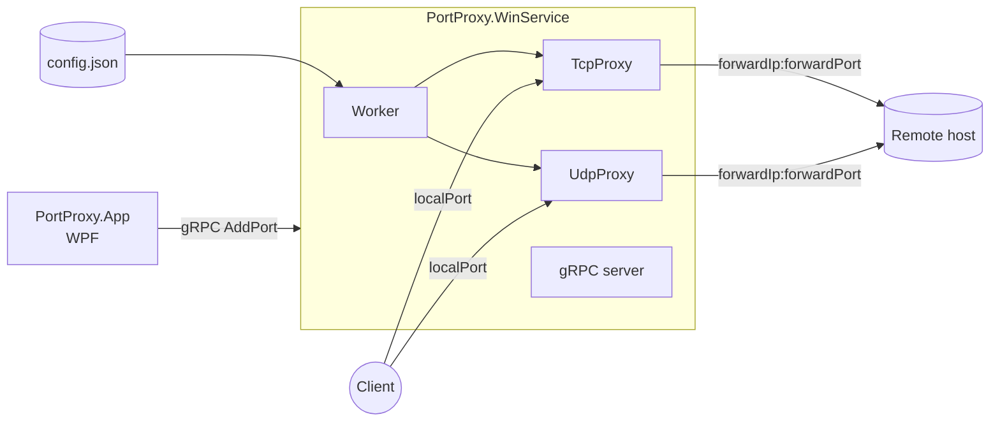

<div align="center">

# 🔀 PortProxy

**Config-driven TCP/UDP port forwarding for Windows — run it as a service, manage it from a desktop app over gRPC.**

[](https://github.com/mr-aybee/port-proxy/actions/workflows/ci.yml)


[](LICENSE)

</div>

---

## Overview

PortProxy forwards traffic from local ports to remote hosts, supporting TCP, UDP or both on the same port. Rules live in a JSON file; a Windows service hosts the proxies and exposes a gRPC endpoint so a WPF desktop app can add rules at runtime. It is useful for exposing internal services (RDP, game servers, APIs) through a single gateway machine.

## Features

- 🔁 **TCP and UDP forwarding**, or `any` for both on one port
- 🗂️ **JSON rule file** — named proxies with local/remote ports
- 🧱 **Windows service host** (`Microsoft.Extensions.Hosting.WindowsServices`)
- 📡 **gRPC control API** (`PPConnector.AddPort`) for live rule changes
- 🖥️ **WPF desktop app** for managing rules
- ⏱️ Idle connection timeouts and per-connection logging

## Architecture



## Tech stack

| Component | Technology |
| --- | --- |
| Core library | C# · .NET 6 · `TcpListener` / `UdpClient` |
| Service | Worker Service hosted as a Windows service |
| Control plane | gRPC (`Grpc.AspNetCore`, protobuf) |
| Desktop | WPF (.NET 6, Windows) |

## Getting started

### Prerequisites

- Windows 10/11 or Windows Server
- [.NET 6 SDK](https://dotnet.microsoft.com/download/dotnet/6.0)

### Build

```shell
git clone https://github.com/mr-aybee/port-proxy.git
cd port-proxy
dotnet build PortProxy.sln -c Release
```

## Usage

1. Define rules in `PortProxy.WinService/config.json`:

   ```json
   {
     "rdp":  { "localPort": 7779, "protocol": "tcp", "forwardIp": "192.168.1.10", "forwardPort": 3389 },
     "game": { "localPort": 7777, "protocol": "udp", "forwardIp": "203.0.113.5",  "forwardPort": 7777 }
   }
   ```

   `protocol` is `tcp`, `udp` or `any`.

2. Run in the console for testing:

   ```shell
   dotnet run --project PortProxy.WinService
   ```

3. Or install as a Windows service (elevated shell):

   ```powershell
   dotnet publish PortProxy.WinService -c Release -o C:\PortProxy
   sc.exe create PortProxy binPath= "C:\PortProxy\PortProxy.WinService.exe" start= auto
   sc.exe start PortProxy
   ```

4. Launch **PortProxy.App** to add rules at runtime through the gRPC endpoint.

> ⚠️ Open only the ports you need in the Windows firewall, and restrict the gRPC endpoint to trusted networks.

## Project structure

```text
port-proxy/
├── PortProxy/              # Core: TcpProxy, UdpProxy, ProxyConfig, gRPC service + port.proto
├── PortProxy.WinService/   # Worker service host, gRPC startup, config.json
├── PortProxy.App/          # WPF management app
└── Port Proxy.docx         # Original design notes
```

## Development

- `dotnet build PortProxy.sln` builds all three projects; edit `port.proto` to extend the control API.
- CI builds the solution on Windows for every push and pull request.

## Contributing

Contributions are welcome. Read [CONTRIBUTING.md](CONTRIBUTING.md) for the branch, build and pull-request workflow. Please report security issues privately through [GitHub security advisories](https://github.com/mr-aybee/port-proxy/security/advisories/new), not public issues.

## Code of Conduct

This project follows the [Contributor Covenant](CODE_OF_CONDUCT.md). By participating you agree to uphold it.

## License

Released under the [MIT License](LICENSE). © 2026 Abdullah Shahid.
